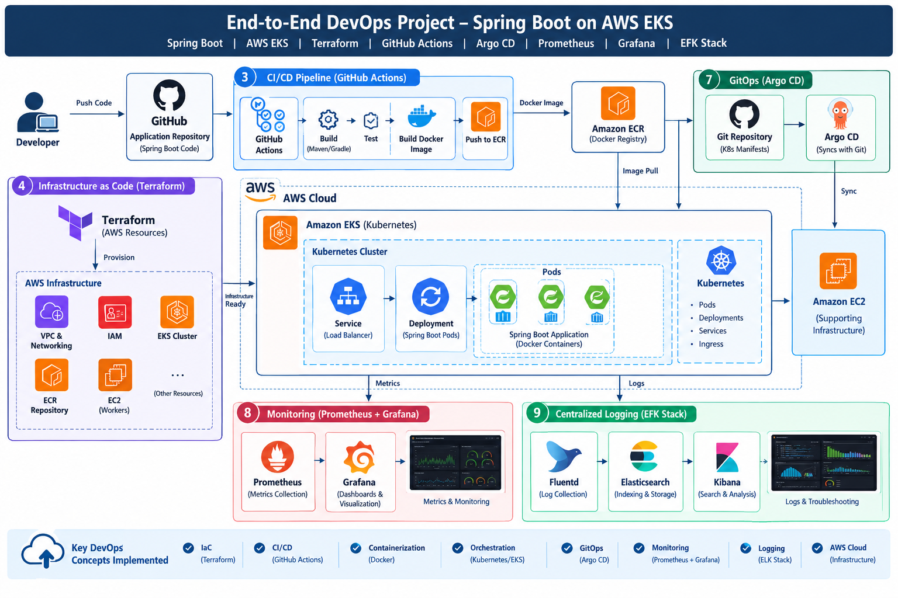

# 🚀 End-to-End DevOps Project: Spring Boot on AWS EKS


## 📌 Project Overview

This project demonstrates an end-to-end DevOps workflow for deploying a Java Spring Boot backend application on **Amazon Elastic Kubernetes Service (EKS)**.

It integrates Infrastructure as Code (IaC), containerization, automated CI/CD, GitOps-based continuous delivery, metrics monitoring, and centralized log management to demonstrate how modern cloud-native applications can be deployed and operated on AWS.

The infrastructure is provisioned using Terraform, Docker images are built and published to Amazon ECR through GitHub Actions, and Argo CD synchronizes Kubernetes resources from a Git repository. Prometheus, Grafana, and the EFK stack provide observability and troubleshooting capabilities.

## 🎯 Project Objectives

- Automate AWS infrastructure provisioning using Terraform.
- Build and containerize a Spring Boot REST API.
- Automate application builds and Docker image publishing.
- Deploy and manage workloads on Amazon EKS.
- Implement GitOps-based deployments using Argo CD.
- Monitor application and Kubernetes metrics.
- Centralize logs for searching and troubleshooting.
- Understand the integration of DevOps tools in a cloud-native environment.

  ## 🏗️ Architecture



> **Note:** The diagram represents the intended end-to-end workflow. Adjust the repository update step to match your actual GitHub Actions implementation.

## 🛠️ Technology Stack

| Technology | Purpose |
|---|---|
| Java | Backend application development |
| Spring Boot | REST API development |
| Docker | Application containerization |
| Amazon ECR | Docker image registry |
| Amazon EKS | Managed Kubernetes orchestration |
| Amazon EC2 | Compute capacity for supporting infrastructure and workloads |
| Terraform | Infrastructure as Code |
| GitHub Actions | Automated CI pipeline |
| Argo CD | GitOps-based continuous delivery |
| Kubernetes | Application deployment and management |
| Prometheus | Metrics collection and monitoring |
| Grafana | Monitoring dashboards and visualization |
| Elasticsearch | Log storage and indexing |
| Fluentd | Log collection and forwarding |
| Kibana | Log search and visualization |


## 🔄 Project Workflow

### 1. Develop the Application
- Develop the backend REST API using Java and Spring Boot.
- Configure application dependencies and environment-specific settings.
- Package the application as a runnable JAR.

### 2. Containerize with Docker
- Create a Dockerfile for the Spring Boot application.
- Build a Docker image.
- Test the container locally before deployment.

### 3. Automate CI with GitHub Actions
- Trigger the pipeline on configured Git events.
- Build and validate the application.
- Build the Docker image.
- Authenticate with Amazon ECR and push the image.

### 4. Provision AWS Infrastructure with Terraform
Use Terraform to define and provision the required AWS resources, such as:

- VPC and networking components.
- IAM roles and policies.
- Amazon EKS cluster and worker nodes.
- Amazon ECR repository.
- Supporting cloud resources.

The exact resources depend on the Terraform configuration in the repository.

### 5. Deploy on Amazon EKS
- Configure Kubernetes Deployments and Services.
- Deploy the Spring Boot application.
- Configure container image references and application settings.
- Use Kubernetes health probes and replica management where configured.

### 6. Implement GitOps with Argo CD
- Store Kubernetes manifests in Git.
- Connect Argo CD to the deployment repository.
- Synchronize the desired application state with the EKS cluster.
- Track deployment status and detect configuration drift.

### 7. Monitor Metrics with Prometheus and Grafana
- Collect available Kubernetes and application metrics.
- Create dashboards to visualize resource utilization and workload health.
- Use PromQL to investigate metrics.
- Configure alerts if supported by the monitoring setup.

### 8. Centralize Logs with EFK
- Collect application and infrastructure logs using Fluentd.
- Forward logs to Elasticsearch for indexing.
- Search and analyze logs using Kibana.
- Troubleshoot errors and investigate application behavior.

## 📂 Repository Structure

The following is a suggested structure. Update it to reflect your actual repository files.

```text
springboot-eks-devops/
├── application/
│   ├── src/
│   ├── build.gradle
│   └── Dockerfile
├── terraform/
│   ├── main.tf
│   ├── variables.tf
│   ├── outputs.tf
│   └── providers.tf
├── kubernetes/
│   ├── deployment.yaml
│   ├── service.yaml
│   └── configmap.yaml
├── .github/
│   └── workflows/
│       └── ci-cd.yml
├── argocd/
│   └── application.yaml
├── monitoring/
│   └── prometheus-values.yaml
├── logging/
│   └── fluentd-values.yaml
└── README.md
```

## ⚙️ Prerequisites

Before starting, make sure you have:

- An AWS account with permissions to create the required resources.
- AWS CLI configured with an appropriate IAM identity.
- Terraform installed.
- Docker installed.
- kubectl installed.
- Helm installed if using Helm-based installations.
- Java and the build tool required by the application.
- A GitHub repository with Actions enabled.
- An Amazon EKS cluster and Amazon ECR repository, or Terraform configurations to create them.
- Argo CD, Prometheus, Grafana, and EFK deployment configurations.

## 🚀 Getting Started

### Step 1: Clone the Repository

```bash
git clone <YOUR_GITHUB_REPOSITORY_URL>
cd <YOUR_REPOSITORY_DIRECTORY>
```

Replace the placeholders with your actual repository URL and directory name.

### Step 2: Configure AWS

```bash
aws configure
aws sts get-caller-identity
```

Verify that the configured AWS identity has the permissions required for the operations you intend to perform.

### Step 3: Provision Infrastructure

Navigate to the Terraform directory:

```bash
cd terraform
terraform init
terraform validate
terraform plan
terraform apply
```

Review the execution plan before applying changes. Configure remote state and state locking appropriately for collaborative use.

### Step 4: Build the Spring Boot Application

For a Gradle project:

```bash
./gradlew clean build
```

On Windows, use:

```powershell
.\gradlew.bat clean build
```

Run the application locally using the generated JAR or your configured Spring Boot task.

### Step 5: Build and Push the Docker Image

After creating your Dockerfile, build the image:

```bash
docker build -t springboot-app:latest .
```

Authenticate Docker with your ECR registry, tag the image, and push it:

```bash
aws ecr get-login-password --region <AWS_REGION> | \
docker login --username AWS --password-stdin <AWS_ACCOUNT_ID>.dkr.ecr.<AWS_REGION>.amazonaws.com

docker tag springboot-app:latest \
<AWS_ACCOUNT_ID>.dkr.ecr.<AWS_REGION>.amazonaws.com/<ECR_REPOSITORY>:latest

docker push \
<AWS_ACCOUNT_ID>.dkr.ecr.<AWS_REGION>.amazonaws.com/<ECR_REPOSITORY>:latest
```

Replace the placeholders with your AWS region, account ID, and ECR repository name.

### Step 6: Connect kubectl to EKS

```bash
aws eks update-kubeconfig \
  --region <AWS_REGION> \
  --name <EKS_CLUSTER_NAME>
```

Verify cluster connectivity:

```bash
kubectl get nodes
kubectl get namespaces
```

### Step 7: Deploy the Application

If deploying directly using Kubernetes manifests:

```bash
kubectl apply -f kubernetes/
```

Check deployment status:

```bash
kubectl get deployments
kubectl get pods
kubectl get services
kubectl rollout status deployment/<DEPLOYMENT_NAME>
```

If Argo CD manages the application, configure the Git repository and application path, then synchronize the application through Argo CD rather than maintaining conflicting deployment methods.

### Step 8: Verify Monitoring and Logging

Check the deployed resources:

```bash
kubectl get pods -A
kubectl get services -A
```

Access Prometheus, Grafana, and Kibana using the endpoints configured for your environment.

## 📊 Monitoring Examples

Example PromQL queries, assuming the relevant metrics are available:

**CPU usage by pod**

```promql
sum by (pod) (
  rate(container_cpu_usage_seconds_total{container!="", pod!=""}[5m])
)
```

**Memory usage by pod**

```promql
sum by (pod) (
  container_memory_working_set_bytes{container!="", pod!=""}
)
```

**Ready Kubernetes nodes**

```promql
kube_node_status_condition{
  condition="Ready",
  status="true"
}
```

Metric availability depends on the exporters and monitoring components installed in the cluster.

## 🔍 Useful Troubleshooting Commands

**Kubernetes resources**

```bash
kubectl get pods -A
kubectl get deployments -A
kubectl get services -A
kubectl describe pod <POD_NAME>
```

**Application logs**

```bash
kubectl logs <POD_NAME>
kubectl logs <POD_NAME> --previous
```

**Investigate pod failures**

```bash
kubectl get events -A --sort-by=.metadata.creationTimestamp
kubectl describe deployment <DEPLOYMENT_NAME>
```

**Argo CD**

```bash
argocd app list
argocd app get <APPLICATION_NAME>
argocd app sync <APPLICATION_NAME>
```

These Argo CD commands require the CLI to be installed and authenticated.

## 🔐 Security Best Practices

- Use IAM roles and least-privilege permissions wherever possible.
- Prefer GitHub Actions OIDC for short-lived AWS credentials instead of long-lived access keys.
- Store sensitive configuration in an appropriate secrets manager.
- Never commit AWS credentials, tokens, private keys, or passwords to Git.
- Restrict public access to Kubernetes APIs and monitoring endpoints.
- Use private networking where appropriate.
- Pin container images and dependencies to controlled versions.
- Enable encryption and access controls for logs and Terraform state.
- Review AWS resources and costs after completing experiments.

## 💡 Key DevOps Concepts Demonstrated

- Infrastructure as Code with Terraform.
- Containerization using Docker.
- Container orchestration using Kubernetes and Amazon EKS.
- CI automation using GitHub Actions.
- Container image management with Amazon ECR.
- GitOps-based continuous delivery using Argo CD.
- Metrics monitoring with Prometheus and Grafana.
- Centralized logging with Elasticsearch, Fluentd, and Kibana.
- Cloud infrastructure troubleshooting and deployment lifecycle management.

## 📚 Learning Outcomes

This project provides practical experience in connecting multiple DevOps tools into an end-to-end deployment workflow. It reinforces infrastructure provisioning, automated image builds, Kubernetes workload management, GitOps reconciliation, observability, and cloud troubleshooting.

## 🔮 Future Improvements

- Add automated unit and integration tests to the CI pipeline.
- Integrate SonarQube for code quality analysis.
- Add image vulnerability scanning.
- Implement progressive delivery with canary or blue-green deployments.
- Configure Alertmanager notifications.
- Add distributed tracing with OpenTelemetry.
- Implement automated rollback and disaster recovery.
- Add resource requests, limits, autoscaling, and cost monitoring.
- Add deployment status badges and architecture screenshots.

## 👨‍💻 Author

**Chandra Shekhar Saini**

Cloud & DevOps Engineer | AWS | Kubernetes | Terraform | Docker | CI/CD | GitOps | Monitoring

- GitHub: [ChandraShekharSaini](https://github.com/ChandraShekharSaini)
- Project Repository: [Add your actual repository URL here](https://github.com/ChandraShekharSaini)

## ⭐ Support

If you find this project useful for learning Cloud and DevOps concepts, consider giving the repository a ⭐ on GitHub.

---

**Disclaimer:** This project is intended for learning and demonstration purposes. Review security settings, AWS costs, and resource configurations before deploying in a production environment.
